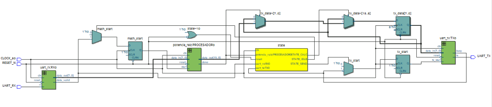

# Reporte de Práctica: Comunicación bidireccional UART entre FPGA DE10-Lite y computadora usando MATLAB y ESP32

Mauricio Morán Riestra  
Patricio Funes San Martín  
Universidad de las Américas Puebla (UDLAP)  
Sistemas Embebidos  
31 de octubre de 2026

## Resumen

Se presenta un sistema de comunicación serial bidireccional entre una computadora con MATLAB y una FPGA DE10-Lite mediante un ESP32 configurado como puente USB–UART. El enlace utiliza 9600 baudios y tramas 8N1. Se describe la interconexión eléctrica, la recepción y transmisión de bytes y la temporización obtenida a partir del reloj de 50 MHz. El diagrama RTL permite identificar los módulos de comunicación y el bloque de procesamiento. La evidencia de MATLAB muestra cuatro intercambios correctos, con entradas 5 y 6 y respuestas 6 y 7, respectivamente, correspondientes al incremento en una unidad. La captura del resultado se incorporará al repositorio de la práctica.

## 1. Objetivo

- Diseñar e implementar un sistema de comunicación serial bidireccional entre una FPGA DE10-Lite y una computadora mediante protocolo UART
- Utilizar scripts en MATLAB para enviar y recibir datos
- Configurar un módulo ESP32 que funcione como puente USB–UART entre la PC y la FPGA
- Lograr que la FPGA transmita, reciba y procese la información serial
- Simular el funcionamiento del sistema en **Active-HDL** (pruebas funcionales) y luego compilar/implementar en **Quartus Lite** para la DE10-Lite.

## 2. Estado del Arte

### 2.1. Comunicación con UART

La comunicación serial asíncrona mediante UART (*Universal Asynchronous Receiver-Transmitter*) tiene un papel importante en el desarrollo de interfaces entre hardware digital y computadoras. A diferencia de protocolos síncronos (como SPI o I2C), no comparte una línea de reloj explícita entre el emisor y el receptor; lo que requiere que ambas partes se configuren a la misma velocidad de transmisión o *baud rate*, estructurando los datos en tramas compuestas por un bit de inicio (*start bit*), 8 bits de datos, sin paridad y un bit de paro (*stop bit*) (configuración 8N1).

### 2.2. Conexión a PC con ESP32

En la arquitectura de sistemas embebidos modernos orientados a FPGA, la conexión con una PC suele llevarse a cabo a través de un convertidor USB a serial TTL. Se pueden utilizar distintos microcontroladores de bajo costo como puentes de comunicación transparente entre el bus USB de la computadora y la línea UART, entre ellos, el ESP32. Esto es posible a niveles lógicos de 3.3V en GPIO de la FPGA, evitando riesgos de sobrevoltaje y eliminando la necesidad de circuitos integrados dedicados adicionales.

### 2.3. Control mediante MATLAB

El uso de MATLAB como plataforma de adquisición y control permite realizar pruebas de validación rápidas, automatizando el envío de bytes y verificando la respuesta procesada por la FPGA.

## 3. Planteamiento del Experimento

El diseño experimental, descrito en la guía de la práctica [1], se basa en una arquitectura de tres capas: la PC ejecutando MATLAB, el módulo ESP32 fungiendo de puente y la tarjeta FPGA DE10-Lite como procesador central de la comunicación.

Se utilizaron los siguientes materiales para la ejecución de la práctica:

- Tarjeta de desarrollo FPGA DE10-Lite (Intel MAX 10).
- Módulo ESP32 programado en Arduino IDE.
- Computadora personal con Quartus Prime Lite Edition y MATLAB.
- Cable USB Blaster (programación FPGA) y cable USB para ESP32.
- Cables de conexión Dupont (macho-hembra / hembra-hembra).

Para la PC, se conecta mediante un puerto serial virtual USB al ESP32. El ESP32 retransmite los bytes recibidos a través de su puerto hardware UART2 (GPIO17 como TX y GPIO16 como RX) hacia los pines GPIO de la FPGA DE10-Lite. De igual manera, las respuestas generadas por la FPGA son reenviadas por el ESP32 hacia MATLAB.

La interconexión física se establece de forma cruzada a niveles de 3.3 V:

- GPIO17 (TX del ESP32) → Pin RX de la FPGA.
- GPIO16 (RX del ESP32) ← Pin TX de la FPGA.
- GND del ESP32 ↔ GND de la FPGA (Tierra común indispensable).

### 3.1. Diagrama de bloques y organización del diseño

*Figura 1: Vista RTL del diseño UART incorporada al proyecto. Se identifican el receptor, el bloque de procesamiento, la máquina de estados y el transmisor.*

La Figura 1 muestra las entradas `CLOCK_50`, `RESET_N` y `UART_RX`, así como la salida `UART_TX`. El receptor `uart_rx` reconstruye los datos seriales y presenta un byte junto con la señal `data_valid`. La lógica de control coordina el procesamiento y el inicio de la transmisión. El módulo `uart_tx` convierte cada byte de respuesta en una trama serial y señala su ocupación mediante `busy`.

La operación implementada y validada en esta práctica consiste en incrementar en una unidad el byte recibido:

$$
y=(x+1)\bmod 256,\qquad x\in\{0,\ldots,255\}. \tag{1}
$$

Cuando el receptor entrega un dato válido y el transmisor está disponible, el módulo superior carga el resultado de ocho bits y activa `tx_start`. El ESP32 reenvía la respuesta a MATLAB. El caso 255 → 0 corresponde al desbordamiento de la suma de ocho bits.

La vista RTL incluida conserva un bloque rotulado `potencia_raiz`; esta denominación no corresponde a la operación ensayada. Los resultados de este reporte validan únicamente el incremento de un byte y no operaciones de potencia o raíz. Para que la documentación gráfica coincida completamente con el experimento se requiere una vista RTL de la versión que implementa el incremento.

### 3.2. Configuración del enlace

*Tabla 1: Parámetros de comunicación y conexión.*

| Parámetro | Configuración |
| --- | --- |
| Reloj de FPGA | 50 MHz |
| Velocidad nominal | 9600 baudios |
| Formato | 8 bits, sin paridad, 1 bit de paro |
| Orden de bits UART | Menos significativo primero |
| Estado de reposo / inicio / paro | Alto / bajo / alto |
| Niveles de interfaz | 3.3 V y tierra común |
| TX del ESP32 / RX del ESP32 | GPIO17 / GPIO16 |

El ESP32 debe reenviar los bytes entre la interfaz USB y UART2 sin alterar su contenido. MATLAB debe abrir el puerto correspondiente al ESP32; el monitor serial de Arduino debe permanecer cerrado para evitar que otro programa ocupe el mismo puerto. Tras abrir la conexión se deja un tiempo de estabilización y se descarta cualquier mensaje de arranque antes de comenzar las mediciones. El puerto COM y los pines físicos de la FPGA deben registrarse a partir de la configuración utilizada, sin deducirlos de un ejemplo.

## 4. Casos de estudio y pruebas

### 4.1. Validación por simulación

El procedimiento de validación debe comprobar por separado el receptor, el transmisor y su integración. En el banco de pruebas se genera un reloj de 50 MHz, se aplica el reinicio y se mantiene la línea RX en reposo alto. A continuación se inyectan tramas 8N1 con un tiempo de bit de aproximadamente 104,16 µs. Se verifica que el byte reconstruido coincida con el enviado y que `data_valid` indique su disponibilidad.

Para el transmisor se comprueba el bit de inicio, los ocho bits en orden del menos al más significativo y el bit de paro, además del comportamiento de `busy`. En la integración se revisa que la máquina de estados espere la finalización del procesamiento y coordine cada byte de salida sin iniciar otra transmisión mientras el transmisor esté ocupado. Una vista RTL documenta la estructura del circuito, pero no sustituye una captura de sus formas de onda.

### 4.2. Pruebas en hardware y registro de resultados

La prueba bidireccional se realizó desde MATLAB: se ingresó un valor entre 0 y 255, se transmitió como un byte al ESP32 y se observó la respuesta de la FPGA en la consola. El puente transportó la solicitud y la respuesta entre la computadora y la FPGA. La captura proporcionada documenta los cuatro intercambios de la Tabla 2.

*Tabla 2: Comparación de resultados esperados y observados en la consola de MATLAB.*

| Ensayo | Enviado | Esperado / recibido | Verificación |
| --- | --- | --- | --- |
| 1 | 5 | 6 / 6 | Coincide |
| 2 | 6 | 7 / 7 | Coincide |
| 3 | 5 | 6 / 6 | Coincide |
| 4 | 6 | 7 / 7 | Coincide |

En los cuatro intercambios documentados la respuesta coincide con $y=x+1$. La repetición de las entradas 5 y 6 produjo nuevamente las respuestas 6 y 7, respectivamente. Esto demuestra el envío, procesamiento y retorno correctos para los valores observados; no equivale a una prueba exhaustiva de las 256 entradas ni a una medición de tasa de error del enlace.

El caso límite 255 → 0 se deduce de la aritmética de ocho bits y queda como prueba adicional, ya que no aparece en la captura. También pueden añadirse los patrones `0x00`, `0x55`, `0xAA` y `0xFF` para ampliar la cobertura.

**Repositorio de evidencia.** La captura de la consola con los intercambios anteriores se incorporará al repositorio de la práctica: [https://github.com/PFunes19/Sistemas-Embebidos-2026](https://github.com/PFunes19/Sistemas-Embebidos-2026). Se referencia el repositorio en lugar de insertar esa imagen en el documento. La disponibilidad de la captura en el repositorio queda pendiente de su carga. Las formas de onda de simulación y las fotografías del montaje UART no se consideran evidencias verificadas en este reporte.

## 5. Análisis de resultados

### 5.1. Divisor de baudios y error de cuantización

Con $F_{\mathrm{CLK}}=50\,000\,000\,\mathrm{Hz}$ y una velocidad nominal $B=9600$ baudios, el número ideal de ciclos por bit es

$$
N_{\mathrm{ideal}}=\frac{F_{\mathrm{CLK}}}{B}=5208{,}3333. \tag{2}
$$

Al utilizar un divisor entero de $N=5208$ ciclos, el contador recorre de 0 a 5207. El periodo de bit y la velocidad resultante son

$$
T_{\mathrm{bit}}=\frac{5208}{50\,000\,000}=104{,}16\,\mu\mathrm{s}, \tag{3}
$$

$$
B_{\mathrm{real}}=\frac{50\,000\,000}{5208}\approx9600{,}6144\,\mathrm{baudios}. \tag{4}
$$

El error relativo respecto del valor nominal es

$$
\varepsilon=\frac{B_{\mathrm{real}}-9600}{9600}\times100\approx0{,}0064\%. \tag{5}
$$

Este valor cuantifica únicamente el redondeo del divisor; no incluye tolerancias de los osciladores, ruido eléctrico ni errores del receptor.

### 5.2. Duración de trama y transferencia útil

Una trama 8N1 contiene diez bits: uno de inicio, ocho de datos y uno de paro. Por tanto,

$$
T_{\mathrm{trama}}=10T_{\mathrm{bit}}=1{,}0416\,\mathrm{ms}. \tag{6}
$$

La tasa útil máxima teórica por dirección, sin pausas entre tramas, es aproximadamente 960 bytes/s. Para una petición de un byte y una respuesta de $k$ bytes que comienza después de recibir y procesar la petición, el tiempo de serialización es $(1+k)T_{\mathrm{trama}}$. A este tiempo se añaden el cálculo en la FPGA, las esperas del puente USB y la ejecución del programa de la computadora. Estos valores son estimaciones teóricas y no mediciones de latencia del montaje.

### 5.3. Integridad de datos y limitaciones

La configuración 8N1 no incorpora paridad ni una suma de comprobación de aplicación. Recibir una respuesta no demuestra por sí mismo ausencia de errores: es necesario comparar el valor completo con el esperado y registrar el número de ensayos. Sin esa información no puede calcularse una tasa de error experimental.

La entrada UART es asíncrona respecto del reloj de la FPGA; el diseño debe contemplar sincronización, detección del inicio y muestreo de los bits en instantes adecuados. También debe definir cómo trata tramas inválidas y nuevos datos mientras procesa o transmite una respuesta. Si no existe almacenamiento de solicitudes, conviene emplear un esquema de petición–respuesta y esperar la respuesta completa antes de enviar el siguiente dato.

## 6. Cuestionario

1. **¿Qué diferencia existe entre UART y RS232?** UART define la conversión entre datos paralelos y tramas seriales asíncronas. RS232 especifica características eléctricas y de interfaz. Una UART puede utilizar niveles lógicos de 3.3 V y conectarse a una interfaz RS232 mediante un transceptor adecuado.

2. **¿Por qué no conectar RS232 directamente a un GPIO?** Sus niveles de tensión e inversión lógica no son compatibles con las entradas de 3.3 V de la FPGA; una conexión directa puede dañarlas. El enlace de esta práctica utiliza UART a niveles lógicos compatibles.

3. **¿Qué función cumple el baud rate?** Establece la velocidad de señalización y, en este enlace binario, determina la duración de cada bit. Ambos extremos deben usar velocidades compatibles para muestrear los datos correctamente.

4. **¿Por qué se cruzan TX y RX?** La salida del transmisor de un equipo debe llegar a la entrada del receptor del otro. Conectar TX con TX enfrenta dos salidas y no establece el recorrido correcto de los datos.

5. **¿Qué ventajas ofrece MATLAB?** Permite generar patrones, enviar y recibir bytes, reconstruir respuestas, comparar resultados y automatizar registros y gráficas desde un mismo entorno.

6. **¿Qué función cumple el ESP32?** Reenvía los bytes entre el puerto serial USB de la computadora y la UART conectada a la FPGA. Actúa como puente; el procesamiento descrito por el diagrama se realiza en la FPGA.

## 7. Conclusiones

La arquitectura UART permite intercambiar información en ambos sentidos entre MATLAB y la FPGA mediante el ESP32. El puente facilita el acceso desde un puerto serial virtual y la compatibilidad de niveles lógicos de 3.3 V simplifica la interconexión, siempre que se crucen TX y RX y se comparta tierra.

El cálculo del divisor permite obtener un periodo de bit de 104,16 µs con un error de cuantización aproximado de 0,0064 %. La coincidencia de velocidad y formato entre los extremos resulta esencial para interpretar las tramas. MATLAB ofrece un medio práctico para generar solicitudes y comparar las respuestas completas con la función implementada.

El diagrama incorporado documenta la integración de recepción, procesamiento y transmisión. Los cuatro intercambios registrados en MATLAB confirman que las entradas 5 y 6 generan las respuestas 6 y 7, de acuerdo con el incremento de un byte. La comunicación bidireccional y el procesamiento quedaron demostrados para estos casos. El caso límite 255 a 0 y las demás entradas no se verificaron en la evidencia disponible. La captura del resultado se incorporará al repositorio; no se atribuyen mediciones de latencia ni una tasa de error a partir de estos cuatro ensayos.

## Referencias

[1] UDLAP, *Práctica 4: Comunicación bidireccional UART entre FPGA DE10-Lite y computadora usando MATLAB y ESP32*, guía de laboratorio proporcionada para esta práctica.

[2] M. M. Mano y M. D. Ciletti, *Digital Design: With an Introduction to the Verilog HDL, VHDL, and SystemVerilog*, 6a ed. New York, NY, USA: Pearson, 2018.

[3] S. Brown y Z. Vranesic, *Fundamentals of Digital Logic with Verilog Design*, 3a ed. New York, NY, USA: McGraw-Hill, 2014.
